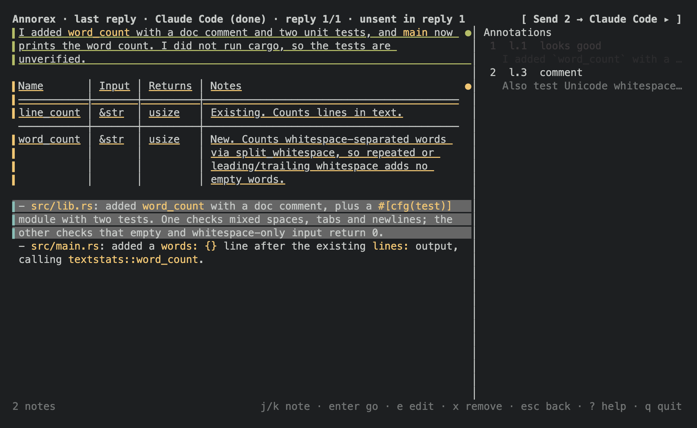
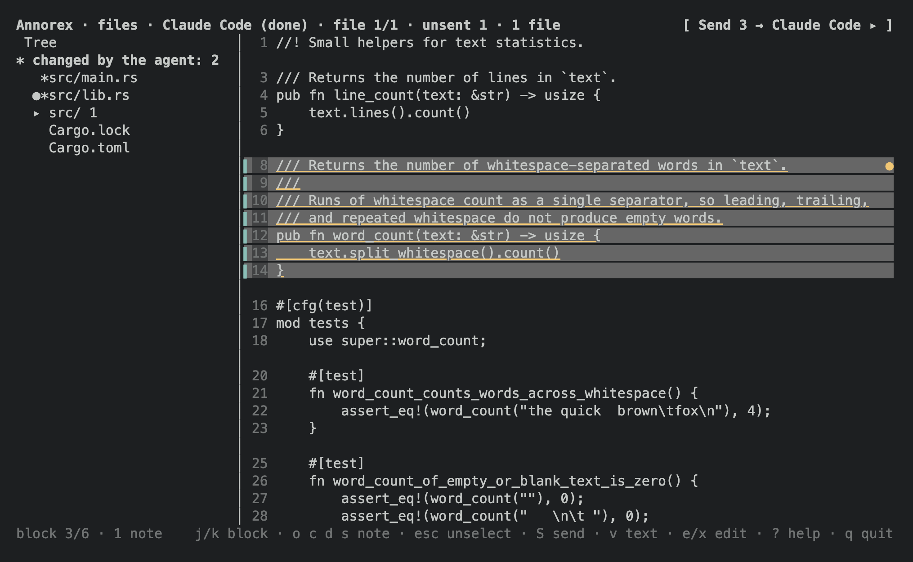
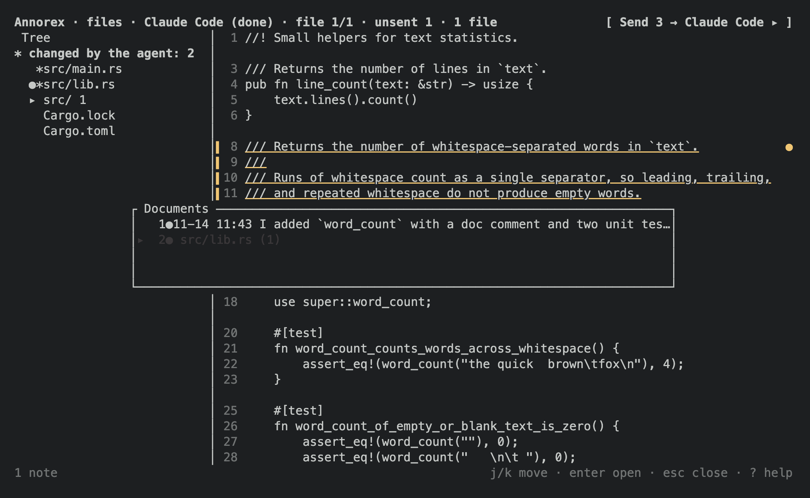

# Annorex

Annotate the replies and files of a coding agent in a [Rex](https://www.superlogical.com/rex) pane, then send your
notes back to the agent.

[![CI][ci-badge]][ci]
[![License: MIT][license-badge]](LICENSE)
[![Platform: macOS][platform-badge]](#install)

[ci-badge]: https://github.com/devararishivian/annorex/actions/workflows/ci.yml/badge.svg
[ci]: https://github.com/devararishivian/annorex/actions/workflows/ci.yml
[license-badge]: https://img.shields.io/badge/license-MIT-blue.svg
[platform-badge]: https://img.shields.io/badge/platform-macOS-lightgrey.svg



Annorex works with Claude Code, Pi, and OpenCode in Rex on macOS. It opens over the window of the agent. You select
the text that you want to change and write a note on it. One key sends all notes to the agent in one message.

> Status: pre-release. No release exists yet. Install Annorex from source with `cargo`.

## Why

A reply of a coding agent is often long. In the chat box of the agent, it is hard to point at one line of that reply.
You copy the text, add your comment, and repeat this for each point.

Annorex lets you mark the exact text instead. Each note quotes its text, so the agent knows which part you mean. Notes
on many replies and files go to the agent in one message. Annorex keeps your notes on disk until the agent gets them.

## Install

You need these items:

- Rex on macOS (Apple silicon).
- Claude Code, Pi 1.5.0 or later, or OpenCode 2.x.
- Rust 1.99 or later, to build from source.

Build and install the `annorex` binary with `cargo`:

```sh
cargo install --git https://github.com/devararishivian/annorex --locked annorex
```

`cargo` puts the binary in `$CARGO_HOME/bin`, else in `~/.cargo/bin`. For more install options, read
[Install](docs/guide.md#install) in the guide.

## Set up Rex

Rex has no plugin system. It has custom actions in its Lua configuration file `init.lua`. Annorex adds two actions.

1. Write the Lua module `annorex.lua` beside the `init.lua` of Rex:

   ```sh
   annorex rex install
   ```

   The command does not change `init.lua`. It prints the path of the binary that Rex starts, after `Rex starts:`.
2. Add these lines to `init.lua`:

   ```lua
   require("annorex").setup{}
   rex.bind("cmd+shift+a", "annorex_last")
   rex.bind("cmd+shift+f", "annorex_files")
   ```

3. Run `rex config reload`.

The action `annorex_last` opens the last reply. The action `annorex_files` opens the files of the work directory of
the agent. The command palette shows them as "Annorex: review the last reply" and "Annorex: review files".

## Annotate the last reply

1. Focus the pane of Claude Code, Pi, or OpenCode.
2. Press `cmd+shift+a`. Annorex opens over the full window of the agent.
3. If the agent has two or more replies, choose one in the list and press `enter`. The newest reply is selected first.
   The list holds the 25 newest replies. Press `p` later to open the list again.
4. Press `j` or `k` to choose a block, or click one. A block is a paragraph, a list item, a heading, a code block, or a
   table.
5. Press `o` to mark the block as good or `c` to comment. Press `d` to mark it for removal or `s` to replace it.
6. For `c` and `s`, type the note in the note box and press `enter`. `o` and `d` save at once and need no text.

To annotate a part of a block, press `v` and move the cursor to select text. This is text mode. Press `v` again to end
the selection and show the action bar. The action bar has the four note types. You can also drag the mouse over text.

## Annotate files



1. Focus the pane of the agent.
2. Press `cmd+shift+f`. Annorex opens with the file tree of the work directory of the agent.
3. Choose a file in the tree and press `enter`. Or press `ctrl+p` and type a part of its name.
4. Annotate the file with the same keys as a reply.
5. Open more files in the same way. Press `[` or `]` to go to the previous or the next open file.

The tree puts the files that the agent changed since your last prompt at the top, marked with `*`. When the agent
changes an open file, a banner shows. Press `r` to read the file again. Your notes move with their text.

## Send the notes to the agent



Press `S`, or click the send button `[ Send N → agent ▸ ]` in the header. One message holds the notes on all replies
and files. A send gives only the notes that Annorex did not send before.

Before it sends, Annorex makes sure that the agent can take the message:

- A supported agent runs in the pane.
- The agent reported its state to Rex.
- The agent shows no dialog, for example a permission prompt.
- The pane of the agent turned on bracketed paste.

Then Annorex pastes the notes into the input box of the agent and presses Enter. An idle agent starts to work on the
notes. When the agent is busy, Claude Code queues the message. Pi and OpenCode use it to steer the current task. The
send button shows `queued` or `steers` while the agent works.

After a successful send, Annorex closes. The sent notes leave the draft on disk, and Annorex deletes an empty draft.
If the send fails, Annorex stays open, keeps your notes, and shows the reason in the footer. If a dialog opens after
the paste, Annorex does not press Enter. Annorex then stays open and marks the notes as sent. Answer the dialog, then
press Enter in the agent pane.

Press `P` to paste the notes without Enter. Press `Y` to copy the notes. Annorex saves your notes after each change.
When you close Annorex, it keeps the notes that you did not send.

## Keys

Press `?` in Annorex to see all keys. This table gives the main keys.

| Key                 | Function                                                                  |
|---------------------|---------------------------------------------------------------------------|
| `j` / `k`           | Go to the next or the previous block                                      |
| `g` / `G`           | Go to the first or the last block (the start or the end in text mode)     |
| `ctrl+d` / `ctrl+u` | Scroll half a page                                                        |
| `v` / `V`           | Select characters or lines (text mode)                                    |
| `h` `l` `w` `b`     | Move by character or by word (text mode)                                  |
| `enter`             | Show the action bar for the focused block                                 |
| `o` / `d`           | Note: looks good or remove. Both save at once and need no text            |
| `c` / `s`           | Note: comment or replace. Both open the note box                          |
| `e` / `x`           | Edit or delete the note at the focus                                      |
| `S`                 | Send the notes to the agent                                               |
| `M`                 | Write a general note, then send                                           |
| `P`                 | Paste the notes into the agent input box, without Enter                   |
| `Y`                 | Copy the notes                                                            |
| `X`                 | Discard the notes of the document on the screen (asks first)              |
| `a`                 | Move the focus to the list of notes                                       |
| `p`                 | Open or close the list of replies and open files                          |
| `T`                 | Hide or show the file tree                                                |
| `tab`               | Move the focus between the tree, the document, and the card rail          |
| `ctrl+p`            | Find a file by name                                                       |
| `[` / `]`           | Show the previous or the next open file                                   |
| `W`                 | Close the file on the screen                                              |
| `/`                 | Find text                                                                 |
| `r`                 | Read the transcript and the files again                                   |
| `?`                 | Show the help screen                                                      |
| `esc`               | Step back one level. With nothing selected or focused, quit               |
| `q`                 | Quit when no note box or text input is open. With unsent notes, ask first |

You can change the keys in the configuration file `config.toml`. The guide lists all keys, the mouse actions, the action
names, and the configuration file: [docs/guide.md](docs/guide.md).

## Lua options

`setup{}` takes one option, `bin`. It gives the path of the `annorex` binary:

```lua
require("annorex").setup{ bin = "/path/to/annorex" }
```

Rex runs actions with a short `PATH` (`/usr/bin:/bin:/usr/sbin:/sbin`), not the `PATH` of your shell. Without `bin`,
the module uses the first of these files that exists:

1. The binary that ran `annorex rex install`.
2. `$CARGO_HOME/bin/annorex`, else `~/.cargo/bin/annorex`.
3. `/opt/homebrew/bin/annorex`, then `/usr/local/bin/annorex`.
4. `~/.local/bin/annorex`.

The guide tells more about `bin` and the error messages of the module: [Lua options](docs/guide.md#lua-options).

## How it works

Annorex has two parts. A small Lua module adds the actions to Rex. A Rust binary does all other work. The binary
reads the transcript of the agent from disk, shows it with Ratatui, and talks to Rex only through the `rex` command.
It never opens a network port. For the full design, read [docs/ARCHITECTURE.md](docs/ARCHITECTURE.md).

## Documentation

- [docs/guide.md](docs/guide.md): all keys, layouts, commands, configuration, and troubleshooting.
- [docs/ARCHITECTURE.md](docs/ARCHITECTURE.md): the design of Annorex.
- [CONTRIBUTING.md](CONTRIBUTING.md): how to build, test, and send a pull request.

## Give Annorex a star

If Annorex helps you review the work of your agent, give the repository a star on GitHub. A star helps other Rex users
find Annorex. It also tells us that the work is useful.

## Acknowledgements

These projects are the base of the Annorex idea:

- [Plannotator](https://github.com/backnotprop/plannotator) by backnotprop. Plannotator started the "annotate, then send
  back to the agent" review method.
- [herdr-annotate](https://github.com/plannotator/herdr-annotate) and
  [plannotator-tui](https://github.com/plannotator/plannotator-tui) by Plannotator and Michael Ramos. These projects do
  the same review in a terminal. Annorex uses the transcript readers from plannotator-tui under the MIT License. See
  [THIRD_PARTY_NOTICES.md](THIRD_PARTY_NOTICES.md).
- [memex](https://github.com/nicosuave/memex) by Nico Ritschel. memex shows how to connect a Rust tool to Rex.

The idea of the full-window layer comes from herdr-annotate and memex, which both cover the screen. Annorex adds the
rule of one review layer for each session. Two more ideas come from plannotator-tui. Annorex tests the Lua module with
`rex config check` on a scratch copy. It finds the window of the agent pane with `session.describe_block`.

Annorex uses these projects:

- [Ratatui](https://github.com/ratatui/ratatui) draws the terminal interface.
- [crossterm](https://github.com/crossterm-rs/crossterm) reads the keys and the mouse and controls the terminal.
- [Rex](https://www.superlogical.com/rex) is the terminal that Annorex runs in. Its custom actions and its `rex`
  command make the integration possible.

Annorex is an independent project. It has no connection to these projects, and they do not endorse it.

## License

Annorex is available under the MIT License. See [LICENSE](LICENSE).
