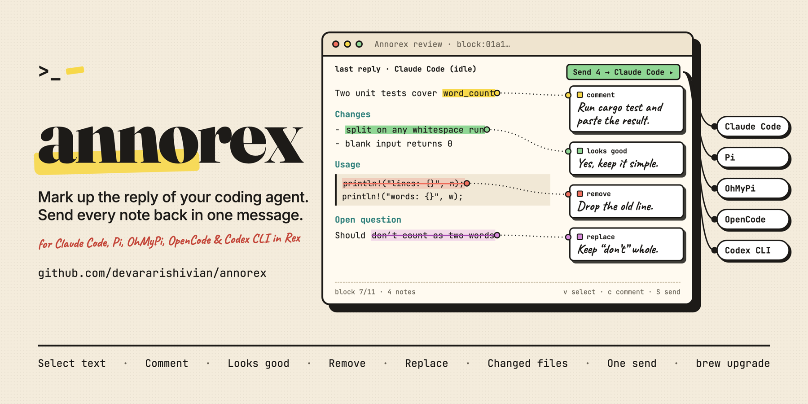
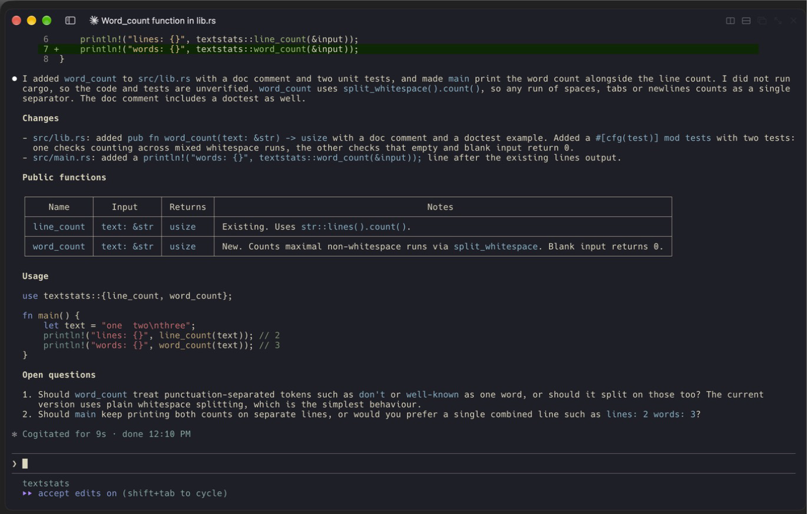
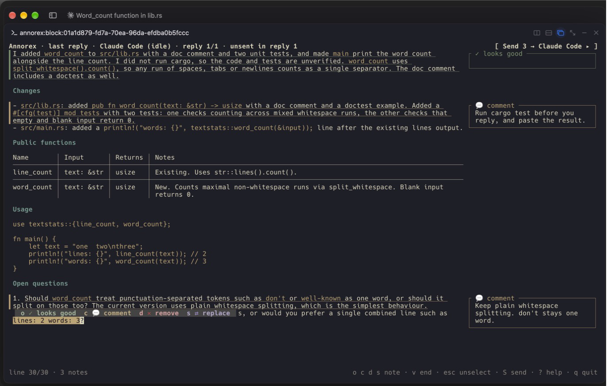
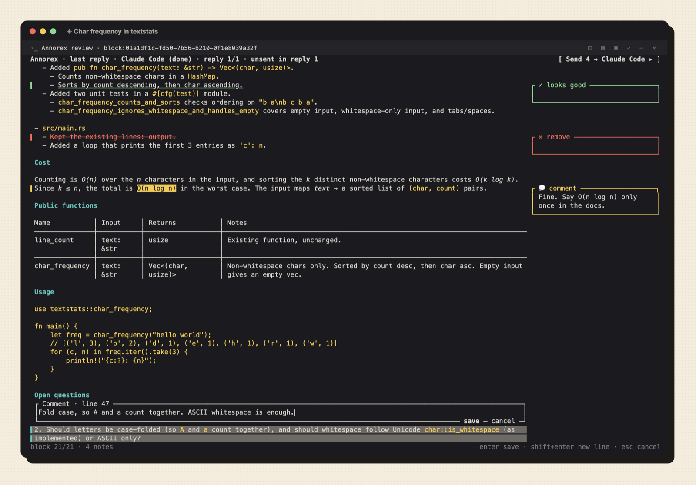
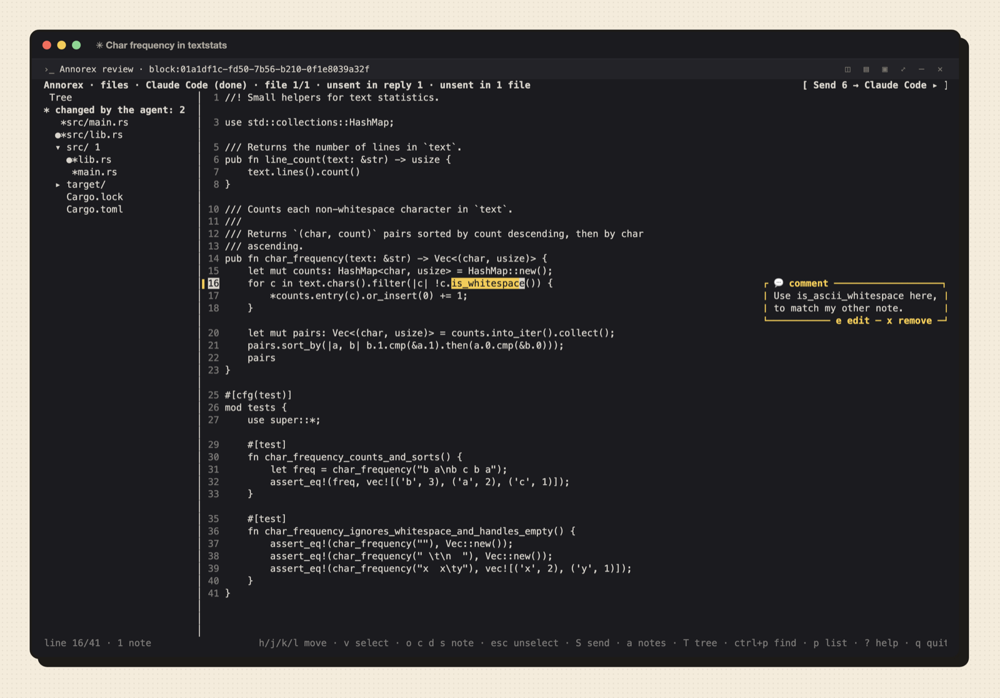
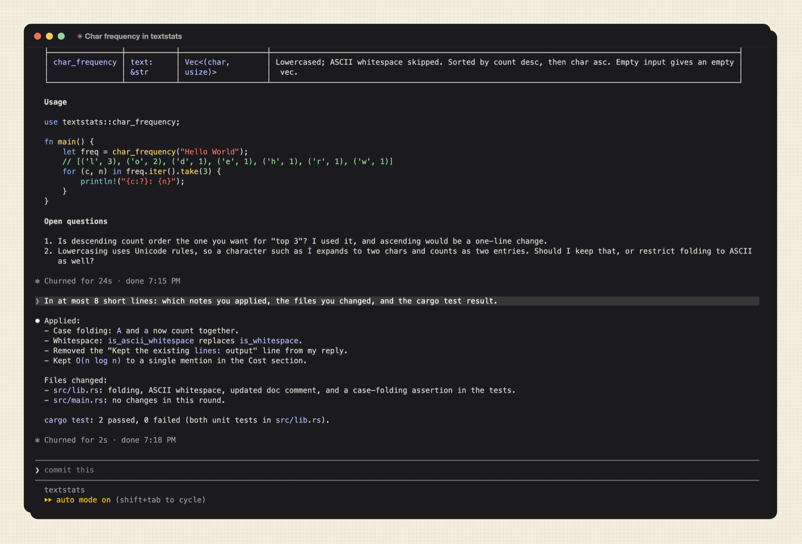

# Annorex

Annotate the replies and files of a coding agent in a [Rex](https://www.superlogical.com/rex) pane, then send your
notes back to the agent.

[![CI][ci-badge]][ci]
[![Release][release-badge]][release]
[![License: MIT][license-badge]](LICENSE)
[![Platform: macOS][platform-badge]](#install)

[ci-badge]: https://github.com/devararishivian/annorex/actions/workflows/ci.yml/badge.svg
[ci]: https://github.com/devararishivian/annorex/actions/workflows/ci.yml
[release-badge]: https://img.shields.io/github/v/release/devararishivian/annorex
[release]: https://github.com/devararishivian/annorex/releases/latest
[license-badge]: https://img.shields.io/badge/license-MIT-blue.svg
[platform-badge]: https://img.shields.io/badge/platform-macOS-lightgrey.svg



Annorex works with Claude Code, Pi, OpenCode, and Codex CLI in Rex on macOS. It opens over the window of the agent. You
select the text that you want to change and write a note on it. One key sends all notes to the agent in one message.

<details>
<summary>See a review from start to end in five screenshots</summary>

1. The agent finishes a reply in Rex.

   

2. Press `cmd+shift+a`. Annorex opens over the window of the agent. Select text with `v` and the cursor keys. The
   action bar shows the four note types.

   

3. Press `c`, write the comment in the note box, and press `enter`.

   

4. Press `T` to show the file tree. Open a file that the agent changed and write a note on it.

   

5. Press `S`. Annorex sends all notes in one message and closes. The agent works on the notes.

   

</details>

## Why

A reply of a coding agent is often long. In the chat box of the agent, it is hard to point at one line of that reply.
You copy the text, add your comment, and repeat this for each point.

Annorex lets you mark the exact text instead. Each note quotes its text, so the agent knows which part you mean. Notes
on many replies and files go to the agent in one message. Annorex deletes your notes from disk only after a send that
it finished.

## Install

You need these items:

- Rex on macOS (Apple silicon or Intel).
- Claude Code, Pi 1.5.0 or later, OpenCode 2.3.2 or later, or Codex CLI.
- Rust 1.99 or later, only to build from source.

Install the `annorex` binary in one of these three ways.

With Homebrew:

```sh
brew install devararishivian/tap/annorex
```

With the shell installer of the release. It puts the binary in `$CARGO_HOME/bin`, else in `~/.cargo/bin`:

```sh
curl --proto '=https' --tlsv1.2 -LsSf https://github.com/devararishivian/annorex/releases/latest/download/annorex-installer.sh | sh
```

From source, with `cargo`:

```sh
cargo install --git https://github.com/devararishivian/annorex --locked annorex
```

The fully qualified name `devararishivian/tap/annorex` trusts only the Annorex formula. If you want to trust the whole
tap, run `brew trust --tap devararishivian/tap`.

For more install options, read [Install](docs/guide.md#install) in the guide.

## Set up Rex

Rex has no plugin system. It has custom actions in its Lua configuration file `init.lua`. Annorex adds two actions.

Run one command:

```sh
annorex rex install
```

The command writes the Lua module `annorex.lua` beside the `init.lua` of Rex. Then it adds these lines to `init.lua`:

```lua
-- Added by `annorex rex install`. Remove these lines to remove Annorex.
require("annorex").setup{}
rex.bind("cmd+shift+a", "annorex_last")
rex.bind("cmd+shift+f", "annorex_files")
```

The command creates `init.lua` when it is missing. It appends the lines when `init.lua` does not load Annorex. It
does not change `init.lua` when `init.lua` already loads Annorex. It still checks that `init.lua` with
`rex config check`. If the check fails, it prints the Rex message and exits with status 1. Otherwise it reloads Rex. It
leaves out a `rex.bind` line when `init.lua` already binds
that key, and it names the key.

Before it writes, the command runs `rex config check` on the new file. If the check fails, the command does not write
`init.lua`. It exits with code 1 and prints the lines to add by hand. Then it runs `rex config reload`. If the reload
fails, the command prints `Could not reload Rex. Run: rex config reload`. Without `rex` on the path, the command skips
the check and the reload.

To remove Annorex from `init.lua`, delete the lines from the marked comment to the last `rex.bind` line. Then run
`rex config reload`.

To write the module only, run `annorex rex install --no-init`. The command prints the lines. You must add them to
`init.lua` yourself.

The action `annorex_last` opens the last reply. The action `annorex_files` opens the files of the work directory of
the agent. The command palette shows them as "Annorex: review the last reply" and "Annorex: review files".

Codex CLI needs no extra setup. Rex reports the state of Codex. Annorex reads the session files of Codex.

## Update

From version 0.2.0, Annorex tells you about a newer release. The viewer shows one banner line:
`Annorex X is available. Run: HINT`. The hint is `brew upgrade annorex` for a Homebrew install. Otherwise it is
`annorex update`.

Annorex checks at most once each 24 hours, in the background. If the network fails, it shows nothing. The only request
is `GET https://api.github.com/repos/devararishivian/annorex/releases/latest`.

Run `annorex update --check` to look for a newer release without an upgrade. Run `annorex update` to upgrade. The
command
depends on how you installed Annorex:

- Homebrew: it runs `brew upgrade annorex`.
- Shell installer: it runs the latest installer again.
- `cargo install`: it prints the `cargo install` command. You must run it yourself.

After a successful upgrade, `annorex update` runs `annorex rex install`. It prints `Running:` and the command. The
binary of version 0.3.0 does not do this step.

After `brew upgrade`, or an update from version 0.3.0, the next open from Rex writes the new `annorex.lua` and asks Rex
to reload the configuration. If the reload fails, Annorex shows `run: rex config reload` at the next open.

If you use version 0.3.0 and never added the setup lines to `init.lua`, run `annorex rex install` one time.

To turn off the check, use one of these ways:

- Set `update_check = false` in `setup{}`. Use this way for the Rex key actions.
- Set the environment variable `ANNOREX_NO_UPDATE_CHECK=1`. The variable works when you start Annorex from a shell. This
  includes `annorex rex open` from a shell.

## Annotate the last reply

1. Focus the pane of Claude Code, Pi, OpenCode, or Codex CLI.
2. Press `cmd+shift+a`. Annorex opens over the full window of the agent.
3. If the agent has two or more replies, choose one in the list and press `enter`. The newest reply is selected first.
   The list holds the 25 newest replies. Press `p` later to open the list again.
4. Press `j` or `k` to choose a block, or click one. A block is a paragraph, a list item, a heading, a code block, or a
   table.
5. Press `o` to mark the block as good or `c` to comment. Press `d` to mark it for removal or `s` to replace it.
6. For `c` and `s`, type the note in the note box and press `enter`. `o` and `d` save at once and need no text.

If the focused pane is not an agent, Annorex finds the agent panes of the Rex session. With one agent pane, it opens
that pane. With two or more, the command palette asks "Annorex: pick the agent". Choose a pane. The action focuses that
pane and opens Annorex. If you cancel the question, nothing opens and no message shows. If the session has no agent
pane, the action shows an error. The action `annorex_files` works in the same way.

In the note box, the arrow keys, `home`, `end`, `ctrl+a`, and `ctrl+e` move the caret. `ctrl+left` and `ctrl+right` move
by word. `ctrl+w` deletes the word before the caret. `ctrl+u` and `ctrl+k` delete to the start or the end of the line.
A click in the text moves the caret. The text goes in at the caret.

To annotate a part of a block, press `v` and move the cursor to select text. This is text mode. Press `v` again to end
the selection and show the action bar. The action bar has the four note types. You can also drag the mouse over text.

## Annotate files

1. Focus the pane of the agent.
2. Press `cmd+shift+f`. Annorex opens with the file tree of the work directory of the agent.
3. Choose a file in the tree and press `enter`. Or press `ctrl+p` and type a part of its name.
4. Annotate the file with the same keys as a reply.
5. Open more files in the same way. Press `[` or `]` to go to the previous or the next open file.

The tree puts the files that the agent changed since your last prompt at the top, marked with `*`. When the agent
changes an open file, a banner shows. Press `r` to read the file again. Your notes move with their text.

## Send the notes to the agent

Press `S`, or click the send button `[ Send N → agent ▸ ]` in the header. One message holds the notes on all replies
and files. A send gives only the notes that Annorex did not send before.

Before it sends, Annorex makes sure that the agent can take the message:

- A supported agent runs in the pane.
- The agent reported its state to Rex.
- The agent shows no dialog, for example a permission prompt.
- The pane of the agent turned on bracketed paste.

Then Annorex pastes the notes into the input box of the agent and presses Enter. An idle agent starts to work on the
notes. When the agent is busy, Claude Code queues the message. Pi, OpenCode, and Codex CLI use it to steer the current
task. The send button shows `queued` or `steers` while the agent works.

After a successful send, Annorex closes. The sent notes leave the draft on disk, and Annorex deletes an empty draft.
If the send fails, Annorex stays open, keeps your notes, and shows the reason in the footer. If a dialog opens after
the paste, Annorex does not press Enter. Annorex then stays open and marks the notes as sent. Answer the dialog, then
press Enter in the agent pane.

Press `P` to paste the notes without Enter. Annorex asks first, then pastes and closes. Press `Y` to copy the notes.
`S`, `P`, and `Y` work in the document, the file tree, and the list of notes, but not while you write a note. Annorex
saves your notes after each change. When you close Annorex, it keeps the notes that you did not send. After `P` or a
held Enter, the notes stay, marked as sent, until you remove them with `x`.

## Keys

Press `?` in Annorex to see all keys. This table gives the main keys.

| Key                 | Function                                                                  |
|---------------------|---------------------------------------------------------------------------|
| `j` / `k`           | Go to the next or the previous block                                      |
| `g` / `G`           | Go to the first or the last block (the start or the end in text mode)     |
| `ctrl+d` / `ctrl+u` | Scroll half a page                                                        |
| `v` / `V`           | Select characters or lines (text mode)                                    |
| `h` `l` `w` `b`     | Move by character or by word (text mode)                                  |
| `enter`             | Show the action bar for the focused block                                 |
| `o` / `d`           | Note: looks good or remove. Both save at once and need no text            |
| `c` / `s`           | Note: comment or replace. Both open the note box                          |
| `e` / `x`           | Edit or delete the note at the focus                                      |
| `S`                 | Send the notes to the agent                                               |
| `M`                 | Write a general note, then send                                           |
| `P`                 | Paste the notes into the agent input box, without Enter (asks first)      |
| `Y`                 | Copy the notes                                                            |
| `X`                 | Discard the notes of the document on the screen (asks first)              |
| `a`                 | Move the focus to the list of notes                                       |
| `p`                 | Open or close the list of replies and open files                          |
| `T`                 | Hide or show the file tree                                                |
| `.`                 | Show or hide hidden files in the tree                                     |
| `tab`               | Move the focus between the tree, the document, and the card rail          |
| `ctrl+p`            | Find a file by name                                                       |
| `[` / `]`           | Show the previous or the next open file                                   |
| `W`                 | Close the file on the screen                                              |
| `/`                 | Find text                                                                 |
| `r`                 | Read the transcript and the files again                                   |
| `?`                 | Show the help screen                                                      |
| `esc`               | Step back one level. With nothing selected or focused, quit               |
| `q`                 | Quit when no note box or text input is open. With unsent notes, ask first |

You can change the keys in the configuration file `config.toml`. The guide lists all keys, the mouse actions, the action
names, and the configuration file: [docs/guide.md](docs/guide.md).

## Lua options

`setup{}` takes two options. The option `bin` gives the path of the `annorex` binary. The option `update_check = false`
turns off the check for a newer release:

```lua
require("annorex").setup{ bin = "/path/to/annorex", update_check = false }
```

Rex runs actions with a short `PATH` (`/usr/bin:/bin:/usr/sbin:/sbin`), not the `PATH` of your shell. Without `bin`,
the module uses the first of these files that exists:

1. The binary that ran `annorex rex install`.
2. `$CARGO_HOME/bin/annorex`, else `~/.cargo/bin/annorex`.
3. `/opt/homebrew/bin/annorex`, then `/usr/local/bin/annorex`.
4. `~/.local/bin/annorex`.

The guide tells more about `bin` and the error messages of the module: [Lua options](docs/guide.md#lua-options).

## Known limits

- At the first start of Codex in a new folder, Codex asks whether you trust the folder. Do not send notes while this
  question shows. Rex can report Codex as idle, or report no state, at that time. With no state, Annorex refuses to
  send. With idle, Annorex would paste the notes into the question.
- Claude Code asks the same question in a new folder. It does not report the question to Rex. Annorex cannot see it.
  Do not send notes while it shows.

The guide lists all known limits: [Known limits](docs/guide.md#known-limits).

## How it works

Annorex has two parts. A small Lua module adds the actions to Rex. A Rust binary does all other work. The binary
reads the transcript of the agent from disk, shows it with Ratatui, and talks to Rex only through the `rex` command.
It never opens a network port. For the full design, read [docs/ARCHITECTURE.md](docs/ARCHITECTURE.md).

## Documentation

- [docs/guide.md](docs/guide.md): all keys, layouts, commands, configuration, and troubleshooting.
- [docs/ARCHITECTURE.md](docs/ARCHITECTURE.md): the design of Annorex.
- [CONTRIBUTING.md](CONTRIBUTING.md): how to build, test, and send a pull request.

## Give Annorex a star

If Annorex helps you review the work of your agent, give the repository a star on GitHub. A star helps other Rex users
find Annorex. It also tells us that the work is useful.

## Acknowledgements

These projects are the base of the Annorex idea:

- [Plannotator](https://github.com/backnotprop/plannotator) by backnotprop. Plannotator started the "annotate, then send
  back to the agent" review method.
- [herdr-annotate](https://github.com/plannotator/herdr-annotate) and
  [plannotator-tui](https://github.com/plannotator/plannotator-tui) by Plannotator and Michael Ramos. These projects do
  the same review in a terminal. Annorex uses the transcript readers from plannotator-tui under the MIT License. See
  [THIRD_PARTY_NOTICES.md](THIRD_PARTY_NOTICES.md).
- [memex](https://github.com/nicosuave/memex) by Nico Ritschel. memex shows how to connect a Rust tool to Rex. Annorex
  uses its rule for Claude Code project folder names under the MIT License. See
  [THIRD_PARTY_NOTICES.md](THIRD_PARTY_NOTICES.md).

The idea of the full-window layer comes from herdr-annotate and memex, which both cover the screen. Annorex adds the
rule of one review layer for each tab of Rex. Two more ideas come from plannotator-tui. Annorex tests the Lua module
with `rex config check`. The check of `init.lua` runs on a check file beside the real `init.lua`, before the write. It
finds the window of the agent pane with `session.describe_block`.

Annorex uses these projects:

- [Ratatui](https://github.com/ratatui/ratatui) draws the terminal interface.
- [crossterm](https://github.com/crossterm-rs/crossterm) reads the keys and the mouse and controls the terminal.
- [Rex](https://www.superlogical.com/rex) is the terminal that Annorex runs in. Its custom actions and its `rex`
  command make the integration possible.

Annorex is an independent project. It has no connection to these projects, and they do not endorse it.

## License

Annorex is available under the MIT License. See [LICENSE](LICENSE).
